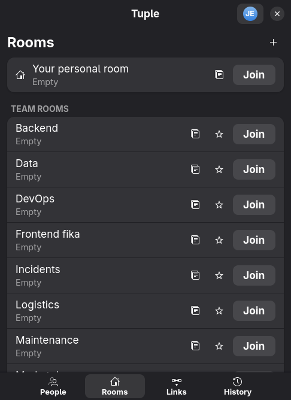
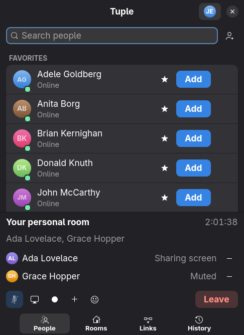
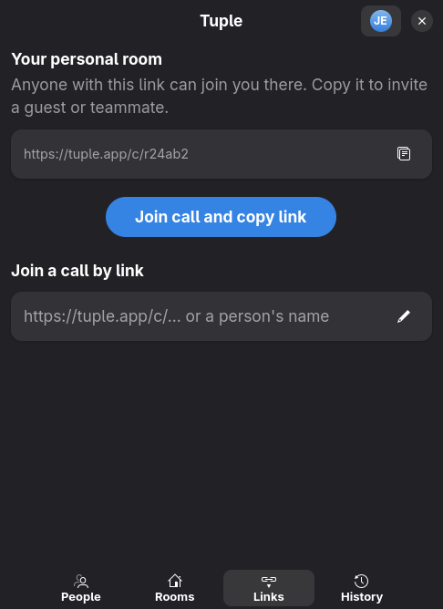
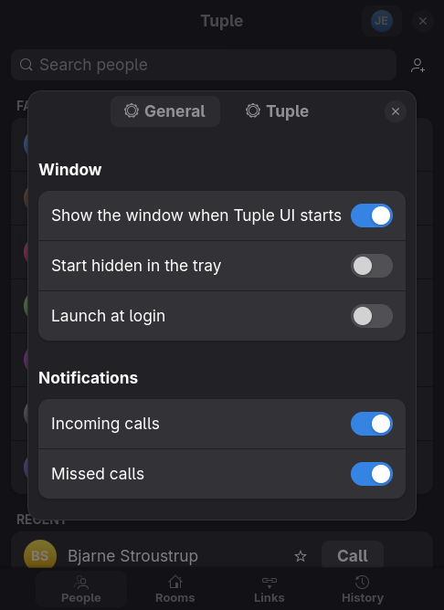

# Tuple UI

A native Linux desktop client for [Tuple](https://tuple.app) pair programming,
built in Rust with GTK 4 and libadwaita on top of the unified `tuple` CLI.

Tuple's own Linux client is command-line only. This app gives it the same
popover the macOS and Windows apps have, translated to GNOME conventions: see
[DESIGN.md](DESIGN.md) for how the two design languages map onto libadwaita.

| People | Rooms | In a call |
| --- | --- | --- |
|  |  |  |

| Links | Settings | Incoming call |
| --- | --- | --- |
|  |  |  |

(Screenshots show the anonymized test data the suite uses, not real contacts.)

## Features

- **People**: searchable contact list with Favorites / Recent / Online /
  Everyone sections, presence dots, one-click Call, favorites, invites and a
  missed-call banner.
- **Rooms**: pinned personal room (join + copy link), team rooms with
  occupants, favorites pinned first, create rooms.
- **Links**: copy your personal room link, join any call by URL or name.
- **History**: captured calls once Capture is available on Linux.
- **In-call bar**: mute, screen share, Capture, add participant, sound
  reactions and Leave/End Call, with participants and call duration.
- **Incoming calls**: a small window plus a desktop notification with Accept /
  Decline.
- **Tray icon** (StatusNotifier): state-coloured dot, quick actions, click to
  show or hide the window. Closing the window hides it to the tray.
- **Settings**: Tuple daemon settings (`tuple settings`) and UI preferences,
  launch at login, notifications.
- **Keyboard shortcuts**: Ctrl+1–4 tabs, Ctrl+F search, Ctrl+M mute,
  Ctrl+Shift+S share, Ctrl+Shift+C capture, Ctrl+Shift+L leave, Ctrl+, settings,
  Ctrl+? shortcut list, Esc hide, Ctrl+Q quit.
- **Global hotkeys**: a second `tuple-ui --toggle-mute` / `--show` /
  `--toggle-window` / `--quit` talks to the running instance over a socket, so
  you can bind them in Hyprland, Sway, GNOME or KDE.
- Follows the system theme, dark/light preference and accent colour.

## Requirements

- The Tuple CLI (`tuple`) on your PATH, v2026.10 or newer, signed in
  (`tuple login`).
- GTK 4.14+ and libadwaita 1.7+ runtime libraries (any current GNOME-based
  distribution has them).
- A StatusNotifier-capable tray (GNOME with AppIndicator, KDE, waybar,
  quickshell, …) for the tray icon; everything else works without one.

## Quick install (binary)

Download the latest release tarball and run its installer. It copies
`tuple-ui` to `~/.local/bin` and adds a desktop entry; no root needed.

```sh
curl -fsSL https://github.com/joakimk/tuple-linux-ui/releases/latest/download/tuple-ui-x86_64-linux.tar.gz | tar xz -C /tmp
/tmp/tuple-ui-x86_64-linux/install.sh
tuple-ui
```

Uninstall with `/tmp/tuple-ui-x86_64-linux/install.sh --uninstall` (or delete
the two files it installed).

## Build from source

Needs a Rust toolchain plus the GTK 4 and libadwaita development packages
(`gtk4` and `libadwaita` on Arch, `libgtk-4-dev libadwaita-1-dev` on Debian/Ubuntu,
`gtk4-devel libadwaita-devel` on Fedora).

```sh
make            # debug build (2 jobs, low priority; JOBS=8 to go faster)
make test       # run the test suite
make dev        # run from source
make install    # release build installed into ~/.local
make dist       # build the release tarball in dist/
make release    # tag, push and publish a GitHub release (maintainers)
```

`tuple-ui --tray` starts hidden in the tray; the Settings dialog can add an
autostart entry that does this at login.

Hyprland example for a global mute key:

```
bind = SUPER SHIFT, M, exec, tuple-ui --toggle-mute
bind = SUPER, T, exec, tuple-ui --toggle-window
```

## Development

The app never parses log files: everything comes from
`tuple state follow --raw --format json`, and every action is a `tuple`
invocation. Tests run without a display and use anonymized recordings of the
real CLI in `tests/fixtures`; `tests/fake_tuple/tuple` replays them as a
stand-in `tuple` binary.

To run the app against the fake data (handy for screenshots):

```sh
mkdir -p /tmp/fake && cp tests/fixtures/state_raw_idle.json /tmp/fake/state_raw.json
head -1 tests/fixtures/follow_raw_solo_call.jsonl > /tmp/fake/follow.jsonl
PATH="$PWD/tests/fake_tuple:$PATH" FAKE_TUPLE_DIR=/tmp/fake TUPLE_UI_OFFLINE=1 cargo run
```

`scripts/dev-screenshot.sh out.png` launches the app, screenshots its window on
Hyprland with `grim`, and quits it.

## License

MIT
